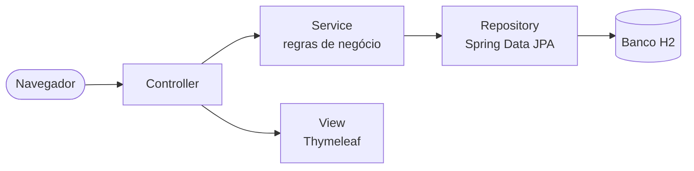
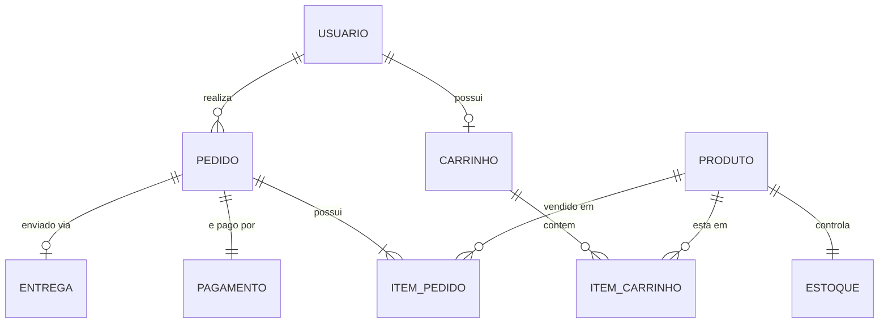
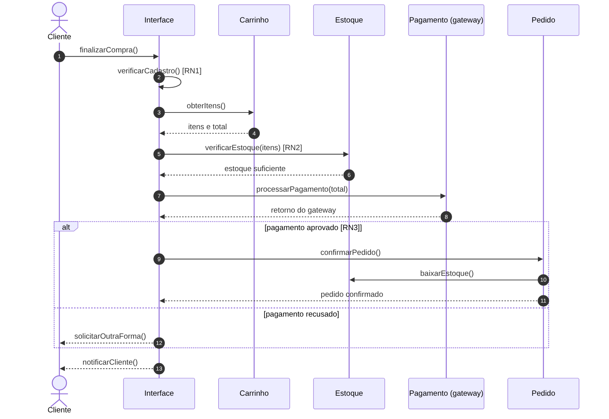
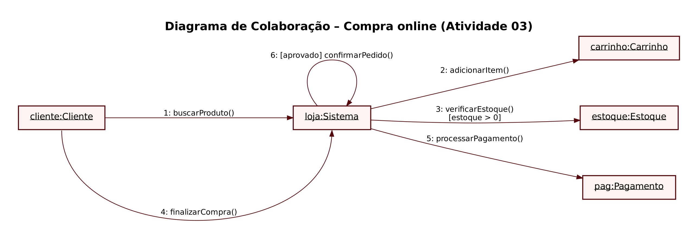

<div align="center">

# 🔥 Flame Commerce

**Compre fácil, receba rápido.**

E-commerce completo em Java, construído a partir da documentação de um projeto Scrum:
requisitos, regras de negócio e diagramas UML viraram código, tela e teste.


</div>

---

## Sobre o projeto

O Flame Commerce nasceu na disciplina **Análise e Projeto de Sistemas**. A equipe simulou um time Scrum
(Product Owner, front-end, back-end, design e QA) e organizou tudo num quadro do Trello:
requisitos funcionais e não funcionais, **cinco regras de negócio**, backlog de histórias de usuário,
matriz de riscos e os diagramas de casos de uso, ER, classes, sequência, colaboração e atividades.

Este repositório é a **implementação** desse material. O objetivo foi simples e exigente:
**nenhuma regra do quadro pode ficar só no papel.** Cada uma tem um lugar no código e um teste que a protege.

A prioridade foi o **frontend e a usabilidade**: interface responsiva, feedback claro em cada ação
e um tema visual próprio, derivado da paleta de outro projeto da equipe (Alexandria).

## O que dá para fazer

**Cliente**
- Navegar pela vitrine, buscar por nome e filtrar por categoria
- Criar conta e entrar (senha protegida com hash BCrypt)
- Montar o carrinho, com bloqueio automático quando o produto não tem estoque
- Finalizar a compra com endereço de entrega e pagamento por **Pix, cartão ou boleto**
- Acompanhar o pedido numa linha do tempo (Confirmado → Enviado → Entregue)
- Cancelar o pedido enquanto ele ainda não foi enviado

**Administrador / vendedor**
- Painel com receita, pedidos, produtos ativos e itens sem estoque
- Cadastro e edição de produtos, com controle de estoque
- Ativar ou desativar produtos sem perder o histórico de vendas
- Gestão dos pedidos: marcar como enviado ou entregue, e cancelar

| Rota | Tela |
|------|------|
| `/` e `/produtos/{id}` | Frente da loja: vitrine, busca, categorias e detalhe |
| `/login` e `/cadastro` | Autenticação |
| `/carrinho` e `/checkout` | Carrinho e finalização |
| `/pedidos` | Acompanhar e cancelar pedidos |
| `/admin` | Painel, produtos/estoque e pedidos (somente ADMIN) |

## Stack

| Camada | Tecnologia |
|--------|------------|
| Linguagem | Java 17 |
| Framework | Spring Boot 3.3 (Web, Data JPA, Validation) |
| Segurança | Spring Security 6 (login por formulário, perfis, CSRF, BCrypt) |
| Views | Thymeleaf + fragmentos reutilizáveis |
| Persistência | Hibernate/JPA + H2 em arquivo (troca simples para MySQL/PostgreSQL) |
| Front | HTML5, CSS3 com *design tokens*, JavaScript puro (sem framework) |
| Testes | JUnit 5 + Spring Boot Test |
| Build | Maven |

## Arquitetura: MVC + Repository



```
src/main/java/com/flamecommerce/
├── controller/   C do MVC: recebe a requisição, valida e escolhe a view
├── service/      regras de negócio (RN1–RN5) e fronteiras transacionais
├── repository/   padrão Repository com Spring Data JPA
├── model/        M do MVC: entidades do diagrama ER
├── dto/          formulários com Bean Validation
├── exception/    exceções de regra de negócio e "não encontrado"
└── config/       segurança, carga de dados de demonstração, dados globais das views

src/main/resources/
├── templates/    V do MVC: páginas Thymeleaf e fragmentos
└── static/       CSS (tokens + componentes), JS e imagens
```

Os controllers **não** contêm regra de negócio: só traduzem HTTP para chamadas de serviço
e exceções de regra para mensagens amigáveis. Os serviços não conhecem HTTP.

## Modelo de dados



## Regras de negócio no código

| Regra do Trello | Como foi implementada | Onde |
|-----------------|-----------------------|------|
| **RN1** Cliente cadastrado para comprar | Rotas de compra exigem autenticação; o serviço revalida | `SecurityConfig`, `PedidoService.finalizarCompra` |
| **RN2** Sem estoque não entra no carrinho | Validação ao adicionar, ao alterar quantidade **e** de novo no checkout | `CarrinhoService`, `PedidoService` |
| **RN3** Pedido só após pagamento aprovado | O pedido só é persistido se o gateway aprovar; recusa não grava nada | `PedidoService.finalizarCompra` |
| **RN4** Vale o preço do momento da compra | `ItemPedido` guarda uma cópia do preço e do nome do produto | `ItemPedido.precoUnitario` |
| **RN5** Cancelar só antes do envio | Cancelamento repõe o estoque e estorna o pagamento | `Pedido.isCancelavel`, `PedidoService.cancelar` |

## Do diagrama ao código

O fluxo de checkout do diagrama de sequência é exatamente o que o `PedidoService.finalizarCompra` executa,
em uma única transação.

<p align="center">
  
</p>

Os diagramas de colaboração (login e compra online) e os arquivos-fonte editáveis
(Mermaid e Graphviz) estão em [`docs/diagramas`](docs/diagramas).

<p align="center">
  
</p>

## Decisões técnicas

**Gateway de pagamento como interface.** O `PagamentoGateway` é uma porta; hoje há uma implementação simulada
(Pix e boleto aprovam sempre, cartão terminado em `0000` é recusado, para demonstrar o fluxo de recusa).
Integrar Mercado Pago ou Stripe significa criar uma nova classe, sem tocar no serviço de pedidos.

**Transação única no checkout.** Validar estoque, congelar preços, autorizar o pagamento, baixar o estoque
e esvaziar o carrinho acontecem juntos. Se qualquer passo falha, nada é gravado.

**Concorrência no estoque.** A entidade `Estoque` usa `@Version` (bloqueio otimista): duas compras simultâneas
da última unidade não vendem o mesmo item duas vezes.

**Produto inativo em vez de excluído.** Pedidos antigos continuam referenciando o produto; desativar o remove
da vitrine sem quebrar o histórico.

**`open-in-view` desligado e consultas explícitas.** As associações que a tela precisa são carregadas com
`@EntityGraph`. Isso rendeu um aprendizado real: com o modo padrão (*fetch*), tudo que não está listado no grafo
vira LAZY, até associações declaradas como EAGER, e a tela de pedidos do admin quebrou com
`LazyInitializationException`. A correção foi usar o modo *load* e listar as associações necessárias.

**Segurança por padrão.** Senhas com BCrypt, proteção CSRF em todos os formulários, rotas `/admin/**` restritas
ao perfil ADMIN, e mensagens de erro internas ocultas ao usuário. HTTPS é requisito do projeto e está
sinalizado na configuração para o deploy.

### Frontend e usabilidade

- **Design tokens:** todas as cores, raios e fontes vivem em `theme.css`; trocar o visual do site inteiro é editar um arquivo.
- **Responsivo de ponta a ponta:** menu recolhível, grids fluidos e tabelas com rolagem no mobile.
- **Feedback em toda ação:** avisos de sucesso e erro, validação campo a campo, estados vazios com chamada para ação.
- **Cuidados de uso:** máscaras em CEP e cartão, mostrar/ocultar senha, confirmação antes de cancelar,
  seletor de quantidade com limite do estoque, selos de "Esgotado" e "Últimas unidades".
- **Acessibilidade:** `label` em todos os campos, `aria-label` nos controles, foco visível,
  respeito a `prefers-reduced-motion`.
- **Sem dependências de imagem:** produtos sem foto ganham um cartão com gradiente quente e emoji, então a vitrine
  fica bonita desde o primeiro acesso.

## Como rodar

Requisitos: **JDK 17+** e **Maven**.

```bash
git clone https://github.com/D4RK1SS/Flame-commerce.git
cd Flame-commerce
mvn spring-boot:run        # http://localhost:8080
mvn test                   # testes das regras de negócio
```

O banco H2 é criado em `./data` e populado na primeira execução com 10 produtos e duas contas de demonstração
(apenas para testes locais):

| Perfil  | E-mail            | Senha      |
|---------|-------------------|------------|
| Admin   | admin@flame.com   | admin123   |
| Cliente | cliente@flame.com | cliente123 |

Para testar a recusa de pagamento, finalize uma compra com **cartão terminado em `0000`**.

## Testes

`RegrasDeNegocioTest` sobe o contexto Spring com banco em memória e verifica:

- produto sem estoque não entra no carrinho e a quantidade não ultrapassa o estoque (RN2)
- pagamento recusado não cria pedido nem baixa estoque (RN3)
- compra aprovada confirma o pedido, baixa o estoque e guarda o preço (RN3 e RN4)
- cancelamento repõe o estoque, e pedido já enviado não pode ser cancelado (RN5)

## Próximos passos

- [ ] Integração com um gateway de pagamento real
- [ ] Perfil de vendedor separado do administrador
- [ ] Upload de imagens de produto
- [ ] Paginação na vitrine e nas listas do admin
- [ ] Migrações de banco com Flyway
- [ ] Docker Compose com PostgreSQL
- [ ] Notificações por e-mail a cada mudança de status
- [ ] HTTPS no deploy

## Autor

**João Pedro** · [GitHub @D4RK1SS](https://github.com/D4RK1SS)

Projeto acadêmico da disciplina Análise e Projeto de Sistemas.
